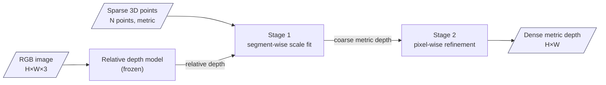

# Page layouts (Notion-flavored Markdown)

## Style rules

- **Emoji policy (strict).** No emoji in page titles, page icons, headings, body text, table cells, or flowchart labels. The only emoji allowed are the fixed callout icons listed below — do not invent others.
  | Callout | Icon | Color |
  |---|---|---|
  | TL;DR / comparison axis | 💡 | yellow_bg |
  | Problem, prior-work limits, commonalities | ▪️ | gray_bg |
  | Key idea, stage boxes, differences | ▪️ | blue_bg |
  | Overlap with the main paper (Similar pages) | ▪️ | purple_bg |
  | Extra notes on results, takeaway | ▪️ | green_bg |
  | Limitations | ⚠️ | red_bg |
- Section headings are plain English text: `## Motivation`, `## Idea (Solution)`, `## Pipeline`, `## Results`, `## Tech`, `## Experiment Setup`, `## Limitations`.
- Keep prose, but inside blocks (callouts, columns, tables, toggles) so the page reads in chunks. Bold lead-ins (`**Problem.**`) instead of extra headings.
- Children of callouts, toggles, and columns must be tab-indented. Table cells hold rich text only.
- Escape special characters outside code blocks as the Notion markdown spec requires.

## Pipeline flowchart (required on every Summary and Similar page)

The flowchart must make **inputs and outputs explicit**:

- Start with one node per input, drawn as a parallelogram, labeled with *what it is* and *its form* (shape, modality, or type): `IN1[/"RGB image H×W×3"/]`, `IN2[/"Sparse LiDAR depth N points, metric"/]`.
- End with one node per output, drawn as a parallelogram, labeled the same way: `OUT[/"Dense metric depth H×W"/]`.
- Middle nodes are the method's stages (rectangles). Mark frozen / pretrained components in the label: `"Marigold U-Net (frozen)"`.
- Label edges with the intermediate data when it is not obvious: `-->|"relative depth"|`.
- Show loops (iterative refinement, per-step guidance) with a back edge labeled with the iteration: `-->|"each denoising step"|`.
- Use `flowchart LR` (or `TB` if there are more than ~7 nodes). Quote every label; line breaks with ` `. No emoji.
- Add `classDef io fill:#eef,stroke:#446;` and `class IN1,IN2,OUT io;` so inputs and outputs stand out.

Example:

## Summary page (Type = Summary)

~~~
<callout icon="💡" color="yellow_bg">
	**TL;DR**
	2–3 sentences of prose: problem, key idea, headline result.
</callout>
## Motivation
<callout icon="▪️" color="gray_bg">
	**Problem.** prose
</callout>
<callout icon="▪️" color="gray_bg">
	**Limits of prior work.** prose
</callout>
## Idea (Solution)
<callout icon="▪️" color="blue_bg">
	**Key idea.** prose
</callout>
## Pipeline
(mermaid flowchart — see rules above)
<columns>      ← when there are 2–3 stages/components: one blue_bg callout per column, bold stage name + prose
## Results
<table header-row="true">  Setting | Compared method (numbers) | This paper (**bold**) | Change  </table>
<callout icon="▪️" color="green_bg"> speed / efficiency / caveats about comparability </callout>   ← optional
## Tech {toggle="true"}                ← only if selected; indented bullets
## Experiment Setup {toggle="true"}    ← only if selected; inside, 2 columns: datasets & applications | metrics, baselines, hardware
## <Extra perspective> {toggle="true"} ← e.g. Threat Model, Dataset, Deployment — only if selected
## Limitations
<callout icon="⚠️" color="red_bg"> prose </callout>
~~~

Similar papers are linked only through the `Related Papers` property — there is no "Similar Papers" section in the body.

## Similar page (Type = Similar)

Same as the summary page, with an overlap block **first**, above TL;DR:

~~~
<callout icon="▪️" color="purple_bg">
	**Overlap with** <mention-page url="...">Main paper</mention-page>
	`keyword 1` · `keyword 2` · `keyword 3` · `keyword 4`
	1–3 sentences of prose: what is shared, and the main difference.
</callout>
<callout icon="💡" color="yellow_bg">
	**TL;DR** ...
</callout>
... (rest as in the summary page)
~~~

Overlap keywords are short noun phrases in inline code, separated by " · ", 3–6 of them.

## Comparison page (Type = Comparison)

~~~
<callout icon="💡" color="yellow_bg">
	**Comparison axis.** the perspectives (and center paper, if any)
	**Conclusion.**
	1. ...
	2. ...
	3. ...
</callout>
## Overview
(optional mermaid flowchart showing where the methods differ — same I/O rules; one subgraph per paper, or one shared pipeline with branches)
## Comparison Table
<table header-row="true" header-column="true">
	rows = one per perspective (short answers), columns = papers (center paper first, bold header)
</table>
## <Perspective name>          ← one section per perspective that needs more than a table cell
<columns> 2 columns; one callout per paper (center paper blue_bg, others gray_bg); bold paper name + prose </columns>
## Commonalities
<callout icon="▪️" color="gray_bg"> prose </callout>
## Differences
<callout icon="▪️" color="blue_bg"> bold lead per difference + prose </callout>
## Takeaway
<callout icon="▪️" color="green_bg"> implications, open combinations, note on comparability of numbers </callout>
~~~
